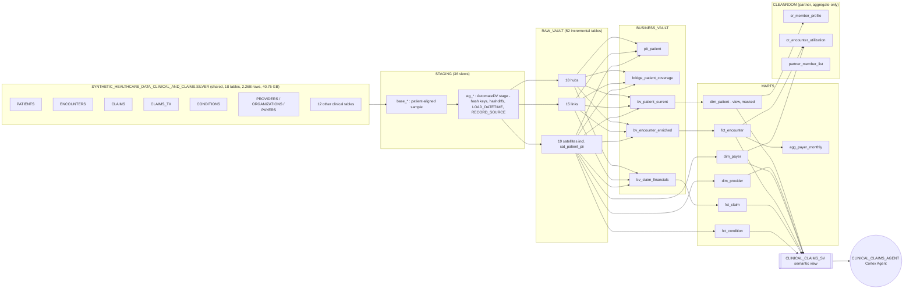
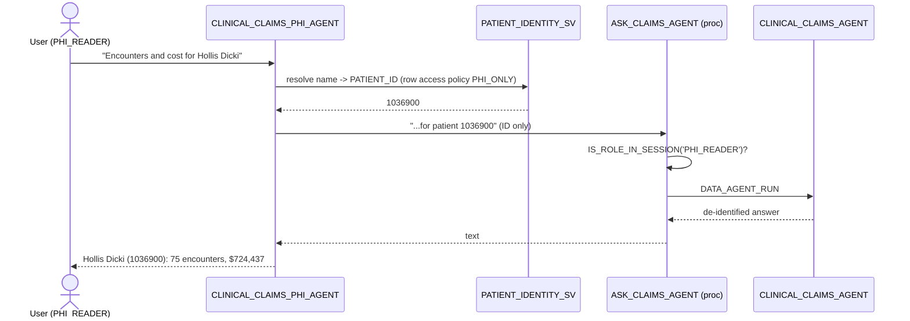

# CLINICAL_CLAIMS_DV — Lineage & Governance Document

_Generated by Claude (Cortex Code) at the Snowflake × Anthropic Workathon, Menlo Park — 2026-10-23._
Every object below was built by the `CLINICAL_CLAIMS_DV.DBT_PROJECTS.CLINICAL_CLAIMS_DV` dbt project (AutomateDV 0.11.2, dbt 1.9.4)
except the semantic view and agent, which are deployed from `semantic/` and `setup/02_cortex_agent.sql`.

## 1. End-to-end lineage



### Verified with Horizon `SNOWFLAKE.CORE.GET_LINEAGE`

| Hop | Verified edge (examples) | Source |
|---|---|---|
| Agent ← semantic view | `CLINICAL_CLAIMS_SV → CLINICAL_CLAIMS_AGENT` | `GET_LINEAGE(agent,'CORTEX_AGENT','UPSTREAM',5)` distance 1 |
| Semantic view ← marts | 6 mart objects → `CLINICAL_CLAIMS_SV` | distance 2 |
| Marts ← vault | e.g. `BV_CLAIM_FINANCIALS → FCT_CLAIM`, `HUB_PATIENT → FCT_ENCOUNTER`, `SAT_PROVIDER_DETAILS → DIM_PROVIDER` | distance 3 |
| Business vault ← raw vault | e.g. `SAT_PATIENT_PII → BV_PATIENT_CURRENT`, `LNK_CLAIM_* → BV_CLAIM_FINANCIALS` | distance 4 |
| Staging ← source | `SILVER.PATIENTS → BASE_PATIENTS → STG_PATIENTS` | `GET_LINEAGE(stg_patients,'TABLE','UPSTREAM',3)` |
| Raw vault ← staging | **Not yet returned by GET_LINEAGE** | Hubs/links/sats are loaded by AutomateDV `INSERT … SELECT` (data movement, not a view dependency). The edge is in the dbt DAG (`manifest.json`, dbt project graph in Snowsight); Horizon data-movement lineage for these loads did not appear at the time of writing. |

## 2. Data Vault model

| Layer | Objects | Notes |
|---|---|---|
| Hubs (18) | patient, provider, organization, payer, encounter, claim, claim_tx, payer_transition, allergy, care_plan, condition, device, imaging_study, immunization, medication, observation, procedure, supply | MD5 hash of the single numeric business key |
| Links (15) | encounter↔patient/provider/org/payer, claim↔patient/provider/encounter, claim_tx↔claim/patient, provider↔org, payer_transition↔patient/payer, 10 clinical events ↔ patient/encounter | |
| Satellites (19) | one `_details` per hub + `sat_patient_pii` | PII split out for masking |
| Business vault | PIT, coverage bridge, current-state/enriched/financials | `pit()` macro is deprecated in AutomateDV 0.11 |

**Dev sample:** `MOD(PATIENT_ID, 50) = 0` → 28,438 patients with *all* their history (1.29M encounters, 2.47M claims, 17.7M claim transactions). 100% of encounter patients resolve to `hub_patient`; 0 orphan claim transactions. Full load: `--vars '{"patient_sample_mod": null}'`.

**Source quality baseline (full source):** 0 duplicate business keys, 0 null keys, 0 orphan patient/provider/payer FKs on encounters and claims; 2 claims with null `ENCOUNTER_ID`.

## 3. dbt tags & metadata → Horizon

| dbt | Snowflake / Horizon |
|---|---|
| folder `+tags`: `layer:staging/raw_vault/business_vault/marts/cleanroom`, `dv:hub/link/sat`, `data_vault` | dbt selectors (`--select tag:dv:hub`) |
| model `tags`: `domain:*`, `pii`, `semantic_layer`, `cleanroom` | dbt selectors |
| `meta.data_layer` / `meta.data_domain` / `meta.data_owner` | `GOVERNANCE.DATA_LAYER / DATA_DOMAIN / DATA_OWNER` object tags (post-hook `apply_governance_tags`) |
| column `meta.sensitivity` | `GOVERNANCE.SENSITIVITY` column tag → tag-based masking |
| column/model `meta.dmfs` | Data Metric Functions attached (post-hook `attach_dmfs`) |
| `description` + `persist_docs` | Table/column comments: all 52 raw vault, 7 marts and 3 clean room objects, 5 of 6 business vault objects; the 36 staging views are not documented yet |

## 4. Protection

### Tag-based masking (`GOVERNANCE.SENSITIVITY` ∈ PII/PHI, unmasked only for `PHI_READER`)

| Object | PII | PHI | Quasi-identifier |
|---|---|---|---|
| RAW_VAULT.SAT_PATIENT_PII | 10 (SSN, DRIVERS, PASSPORT, FIRST, MIDDLE, LAST, MAIDEN, ADDRESS, LAT, LON) | – | ZIP |
| RAW_VAULT.SAT_PATIENT_DETAILS | – | BIRTHDATE, DEATHDATE | BIRTHPLACE |
| BUSINESS_VAULT.BV_PATIENT_CURRENT | FIRST, LAST, ADDRESS | BIRTHDATE, DEATHDATE | ZIP |
| BUSINESS_VAULT.BRIDGE_PATIENT_COVERAGE | MEMBER_ID | – | – |
| MARTS.DIM_PATIENT | FIRST_NAME, LAST_NAME | BIRTHDATE, DEATHDATE | ZIP |

Policies: `MASK_STRING_SENSITIVE` (→ `***MASKED***`), `MASK_NUMBER_SENSITIVE` (→ NULL), `MASK_DATE_SENSITIVE` (→ year), all driven by the shared memoizable `UNMASK_PHI()` function.
Verified: as `ATTENDEE_ROLE` (secondary roles off) SSN/FIRST/LAST return `***MASKED***`, LAT returns NULL.

### Horizon classification (`SYSTEM$CLASSIFY` on `SAT_PATIENT_PII`, auto-tagged)
FIRST/MIDDLE/LAST → `NAME` (IDENTIFIER, HIGH) · SSN → `TAX_IDENTIFIER` (IDENTIFIER, LOW) · LAT/LON → `LATITUDE/LONGITUDE` (QUASI_IDENTIFIER, HIGH) · ZIP → `POSTAL_CODE` (QUASI_IDENTIFIER, HIGH).
Classification of the shared source table is not permitted by Snowflake, and running it under a masked role only detects unmasked columns — run as an unmasking role.

### Clean room (single-account pattern)
| Control | Object | Verified behaviour for `PARTNER_ANALYST` |
|---|---|---|
| Aggregation policy `CLEANROOM_MIN_GROUP_25` | `cr_member_profile`, `cr_encounter_utilization` | Row-level `SELECT` → *"Aggregation policy violation: aggregation required"*; groups < 25 suppressed |
| Projection policy `CLEANROOM_NO_PROJECT_JOIN_KEY` | `MEMBER_JOIN_KEY` (SHA-256 of PATIENT_ID + shared salt) | Selecting the key → *"restricted by a Projection Policy"*; joining on it works |
| Overlap analysis | `cr_member_profile ⋈ partner_member_list` | 9,479 overlapping members, reported by age band only |

To move to a two-account clean room, install the Snowflake Data Clean Rooms app and share `cr_member_profile` through a template.

## 5. Data Metric Functions (`TRIGGER_ON_CHANGES`)

| Scope | DMFs |
|---|---|
| 18 hubs | `ROW_COUNT`, `FRESHNESS` (table), `NULL_COUNT` + `DUPLICATE_COUNT` on the business key |
| 5 mart tables with a PK | `ROW_COUNT`, `NULL_COUNT` + `DUPLICATE_COUNT` on the PK |
| 3 facts | `NULL_COUNT` on `PATIENT_ID` |
| `agg_payer_monthly` | `ROW_COUNT` |

Hash keys are `BINARY` and are covered by dbt `unique`/`not_null` tests (176 tests passing) rather than DMFs, which have no BINARY signatures.
Results: `SELECT * FROM SNOWFLAKE.LOCAL.DATA_QUALITY_MONITORING_RESULTS()` — next phase: expectations, notifications, observability.

## 6. AI layer

| Object | Detail |
|---|---|
| `MARTS.CLINICAL_CLAIMS_SV` | 6 tables, 6 relationships, 15 metrics (coverage ratio, encounters/patient, outstanding balance…), 5 verified queries; patient identifiers excluded |
| `MARTS.CLINICAL_CLAIMS_AGENT` | Cortex Analyst tool over the semantic view; refuses PII requests; owned by `ATTENDEE_ROLE` (USER1, USER2), usage granted to `PHI_READER` |
| `MARTS.PATIENT_IDENTITY` | dbt view: name / birth date / location → PATIENT_ID; row access policy `GOVERNANCE.PHI_ONLY` (rows only when PHI_READER is in session) plus tag masking |
| `MARTS.PATIENT_IDENTITY_SV` | Semantic view over `PATIENT_IDENTITY`; SELECT granted only to PHI_READER |
| `GOVERNANCE.ASK_CLAIMS_AGENT(STRING)` | Caller's-rights Python procedure: checks `IS_ROLE_IN_SESSION('PHI_READER')`, then runs `CLINICAL_CLAIMS_AGENT` via `SNOWFLAKE.CORTEX.DATA_AGENT_RUN` and returns its text |
| `MARTS.CLINICAL_CLAIMS_PHI_AGENT` | Two tools: `patient_identity_lookup` (Cortex Analyst → PATIENT_IDENTITY_SV) and `ask_claims_agent` (procedure). Resolves the name, passes only PATIENT_ID to the claims agent, then labels the answer with the name |

### Agent-to-agent flow (PHI_READER only)



| Test | Role (secondary roles off) | Result |
|---|---|---|
| Named patient → claims answer | PHI_READER | Tools: identity lookup → SQL → ask_claims_agent; "Hollis Dicki, 1036900: 75 encounters, $724,437" |
| Ambiguous name ("Pacheco") | PHI_READER | Lists 5 candidates and asks which one |
| Same question to the PHI agent | ATTENDEE_ROLE | Identity lookup returns 0 rows; no data released |
| `CALL GOVERNANCE.ASK_CLAIMS_AGENT(...)` | ATTENDEE_ROLE | `ACCESS DENIED` |
| `SELECT ... FROM MARTS.PATIENT_IDENTITY` | ATTENDEE_ROLE | 0 rows |

Note: ATTENDEE_ROLE owns the PHI agent and its objects (so it can open them), but cannot get identified data: the row access policy and the procedure's role check both key off PHI_READER. Definition: `setup/03_phi_agent.sql`, `semantic/patient_identity_sv.yaml`.

## 7. Re-run / operate

```sql
USE ROLE ATTENDEE_ROLE;
ALTER DBT PROJECT CLINICAL_CLAIMS_DV.DBT_PROJECTS.CLINICAL_CLAIMS_DV
  DEPLOY FROM 'snow://workspace/user$.public."DEFAULT$"/versions/live/clinical_claims_dv';
EXECUTE DBT PROJECT CLINICAL_CLAIMS_DV.DBT_PROJECTS.CLINICAL_CLAIMS_DV ARGS = 'build';
-- lineage check
SELECT * FROM TABLE(SNOWFLAKE.CORE.GET_LINEAGE('CLINICAL_CLAIMS_DV.MARTS.CLINICAL_CLAIMS_AGENT','CORTEX_AGENT','UPSTREAM',5));
```

One-time setup (already applied): `setup/01_governance_setup.sql`, `setup/02_cortex_agent.sql`, `semantic/clinical_claims_sv.yaml`.
